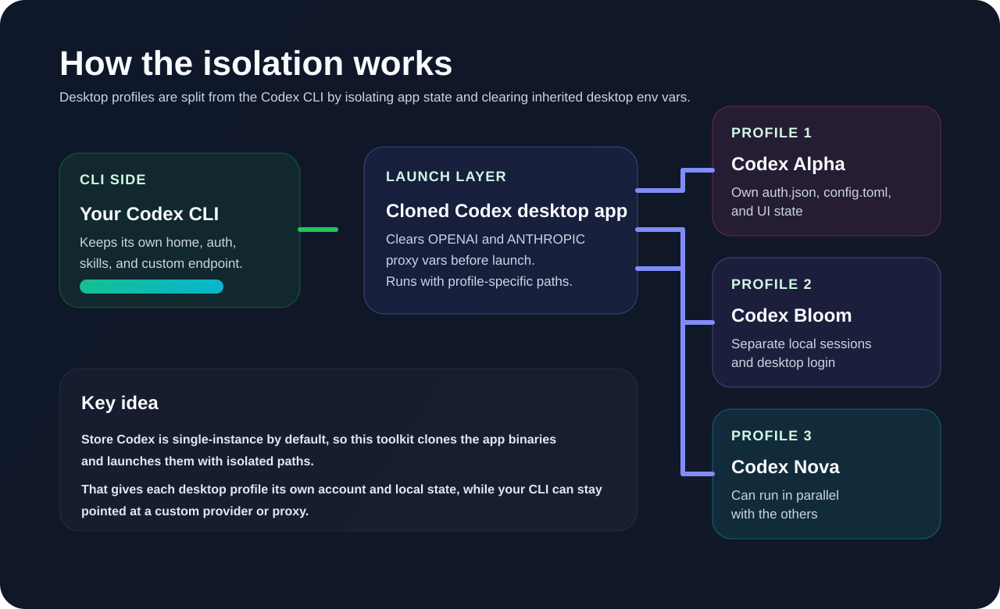

# Codex Profiles

本目录是 EXE 管理器版本，原项目位于 `D:\codex-profiles\codex-profiles`。

双击 `dist\CodexProfiles.exe`，输入实例名，选择独立空间或共享已有实例的会话空间，再确认创建。共享来源可以选择原应用、已有实例，或浏览指定 `CODEX_HOME`。创建完成后，在下方列表中选中实例并启动，首次使用时在新窗口单独登录。

彻底退出多开实例后，在列表中选中它，点击“删除实例”并确认。管理器将该实例的账号、配置和窗口数据移到 `%LOCALAPPDATA%\CodexProfilesDeleted` 下的独立恢复目录。共享来源及会话会保留。若有其他实例依赖该实例作为共享来源，需先移除依赖实例。恢复时，将恢复目录里的 `home` 和 `ui` 移回确认框所列的原路径。

已有实例也从管理器下方列表启动。列表中的“原应用”使用默认账号空间。第一次升级自动刷新功能时，请在方便时完全退出参与同步的旧实例，再从新版管理器各启动一次。看到“自动刷新”列显示“运行中”即表示后台增强已接入。后续新建对话会定时更新到共用空间的其他实例。

- 独立空间分别保存账号、配置和对话。
- 共享空间通过目录连接和 `sqlite_home` 共用会话、数据库、附件、技能及插件。`auth.json`、浏览器登录数据、沙盒凭据和窗口状态分别保存。来源账号的 `auth.json` 不会被复制。
- 共享实例的配置在启动时从来源刷新，并强制使用实例自己的文件凭据。共享实例中修改的配置在下次启动时会被来源配置覆盖。
- 项目侧边栏初始布局在创建时导入，后续窗口布局各自保存。当前版本的账号专属侧边栏状态可能影响对话显示，重新打开项目或会话后查看。
- 后台增强约每 5～6 秒调用应用内部的会话列表刷新接口。刷新只更新列表数据，当前页面、焦点和草稿由应用继续保留。辅助进程在管理器关闭后继续运行，随对应应用实例退出而结束。
- 增强接入复用 `D:\codex-sidebar-usage` 的多开机制，仅使用各实例自己的 `127.0.0.1` 随机调试端口。默认实例也采用该方式。辅助程序只向应用自己的 `app://-/index.html` 页面安装刷新脚本，安装包文件保持原状。
- 共享模式属于实验功能。已用合成数据验证历史读写与账号文件隔离，跨账号实际续聊仍需登录后验证。同一条对话请在一轮结束后轮流操作，目标窗口需重新打开会话以加载最新历史。正在运行的工具、终端和进程不会随历史切换。
- 已有独立实例保留原空间类型。需要共享时使用新实例名。

实例数据默认位于 `%LOCALAPPDATA%\CodexProfiles\<实例名>`，窗口数据位于 `%LOCALAPPDATA%\CodexParallelDesktop\ui\<实例名>`。EXE 的内嵌脚本缓存位于 `%LOCALAPPDATA%\CodexProfilesLauncher\runtime`。共享数据仍保存在所选来源空间。

自动刷新状态保存在各实例自己的 `conversation-sync.json`，原应用的状态位于 `%LOCALAPPDATA%\CodexProfilesLauncher\default`。该文件只记录增强状态和刷新时间。刷新接口属于桌面应用内部实现，官方更新后可能需要适配。

本机构建命令如下，需要 Windows 自带的 .NET Framework 与 Windows PowerShell 5.1。

```powershell
powershell -NoProfile -ExecutionPolicy Bypass -File .\scripts\windows\Build-CodexProfilesExe.ps1
```

下面保留原项目的脚本使用说明。

 

<p align="center">
  
  
</p>

<p align="center">
  
  
  
  
</p>

Windows helpers for running multiple isolated Codex desktop profiles in parallel without touching your Codex CLI home.

## About

`Codex Profiles` is a Windows-focused helper toolkit for people who want multiple Codex desktop identities at the same time without breaking a separate Codex CLI setup.

It is built for setups where you want things like:

- one desktop profile per account or workspace
- parallel Codex windows with isolated local state
- desktop auth separated from a CLI that uses a custom endpoint
- optional MCP defaults for new desktop profiles

## Visual overview



## What this solves

The Microsoft Store Codex desktop app behaves like a single-instance Electron app. Launching the Store app directly does **not** give you true parallel profile isolation.

This repo works around that by:

- detecting the installed `OpenAI.Codex` Store package
- activating the desktop app through its MSIX package identity (current Store builds refuse direct exe launches with "no package identity")
- launching each profile with its own `CODEX_HOME`, published at user scope only for the activation call itself
- launching each profile with its own Chromium `--user-data-dir`
- scrubbing inherited proxy / API environment variables for the activation call

That keeps desktop profiles separate from each other while leaving the Codex CLI home alone.

## What gets isolated

Per profile, this setup isolates local desktop state such as:

- `config.toml`
- `auth.json`
- sessions, memories, skills, sqlite files
- Chromium / Electron UI state
- logged-in desktop account state for that profile

By default, profiles live under:

- profile home: `%LOCALAPPDATA%\\CodexProfiles\\<profile>`
- UI data: `%LOCALAPPDATA%\\CodexParallelDesktop\\ui\\<profile>`

## Requirements and limits

This repo is designed for the same setup used in testing:

- Windows with the Codex desktop app installed from the Microsoft Store
- PowerShell 5.1 or newer
- Node.js only if you want to use `-EnableCommonMcp`

What should work reliably:

- multiple Codex desktop profiles in parallel
- isolated desktop `CODEX_HOME` and isolated Chromium `--user-data-dir`
- desktop launchers that ignore inherited `OPENAI_BASE_URL` / proxy env vars
- keeping the normal Codex CLI home separate from the desktop profiles

What is still environment-dependent:

- future Codex desktop app updates could change internal behavior
- some MCP OAuth credentials may still be stored in the Windows credential store
- launching the normal Store app icon directly bypasses these isolated launchers

## Important caveats

- This does **not** modify `%USERPROFILE%\\.codex`, so Codex CLI stays on its own home unless you change it yourself.
- If you launch the normal Store app directly, it still inherits your normal Windows environment. If your machine has `OPENAI_BASE_URL` or similar user env vars set, the normal Store app can still use them.
- Some MCP OAuth credentials may still live in the Windows credential store outside `CODEX_HOME`. File-based profile state is isolated, but OS keychain-backed credentials can still be shared depending on how Codex stores them.

## Quick start

### 1. Clone the repo

```powershell
git clone https://github.com/ychampion/codex-profiles
cd codex-profiles
```

### 2. Create common named profiles

```powershell
powershell -ExecutionPolicy Bypass -File .\scripts\windows\Install-CodexDesktopProfiles.ps1 -ProfileName alpha,bloom,apex,prime,flow,turbo,sonic,nova -CreateDesktopShortcuts -CreateStartMenuShortcuts
```

### 3. Launch a specific profile

```powershell
powershell -ExecutionPolicy Bypass -File .\scripts\windows\Start-CodexDesktopProfile.ps1 -ProfileName alpha -DisplayName "Codex Alpha"
```

### 4. Create one profile with optional local MCP defaults

```powershell
powershell -ExecutionPolicy Bypass -File .\scripts\windows\New-CodexDesktopProfile.ps1 -ProfileName alpha -DisplayName "Codex Alpha" -EnableCommonMcp -CreateDesktopShortcut
```

Each profile also gets a stop script that only targets the app launched with that profile's UI data directory:

```powershell
powershell -ExecutionPolicy Bypass -File "$env:LOCALAPPDATA\CodexProfiles\alpha\Stop-CodexDesktopProfile.ps1"
```

Launching a profile also starts one profile-specific system tray controller. Double-click its icon to show or restore Codex. Its menu can show the window, hide the window, or exit that profile and its tray controller. Pass `-NoTrayIcon` to `Start-CodexDesktopProfile.ps1` when you do not want a tray icon.

You can append `-WhatIf` to the public scripts or module functions for a dry run. The installer also accepts comma-separated profile names when invoked through `powershell -File`.

## Included scripts

- `scripts/windows/New-CodexDesktopProfile.ps1` creates one isolated profile and optional shortcuts
- `scripts/windows/Start-CodexDesktopProfile.ps1` launches one isolated profile
- `scripts/windows/Install-CodexDesktopProfiles.ps1` provisions a set of named profiles

## Optional MCP defaults

`-EnableCommonMcp` bootstraps a minimal local config with:

- ChatGPT login mode
- OpenAI model provider
- Windows elevated sandbox setting
- optional local `npx`-backed MCP entries for Playwright, Chrome DevTools, and Context7

The MCP block is created only when a new profile config is written, or when you pass `-OverwriteConfig`.

## Troubleshooting

### Microsoft Store app updates

Profiles are activated through the installed Store package at launch time, so app updates are picked up automatically. No refresh step is needed.

Your isolated profile data lives in the profile home and UI data folders, so Store updates do not reset your desktop profiles by themselves.

If an older version of this tool left cloned binaries under `%LOCALAPPDATA%\\CodexParallelDesktop\\versions`, that folder is no longer used and can be deleted.

### MCP auth and OAuth prompts

Profile-local config is isolated, but some MCP authentication flows can still involve the Windows credential store.

That means file-based profile state is separate, while some MCP credentials may be reused or re-prompted depending on the provider.

If an MCP server shows the wrong account, keeps prompting, or behaves differently across profiles:

- reconnect that MCP server from the profile you actually want to use
- if needed, remove the matching Codex or provider-specific entry from Windows Credential Manager and sign in again from the target profile
- expect some providers to reuse OS-level credentials, even when `CODEX_HOME` is isolated

For that reason, local profile separation is strongest for desktop auth, config, sessions, and UI data. MCP OAuth behavior can still vary by provider.

## Recommended naming set

The default profile set used by the installer is:

- `alpha`
- `bloom`
- `apex`
- `prime`
- `flow`
- `turbo`
- `sonic`
- `nova`

## Verification

The launchers are designed to avoid inherited desktop proxy settings such as:

- `OPENAI_BASE_URL`
- `OPENAI_API_KEY`
- `OPENAI_ORG_ID`
- `OPENAI_PROJECT_ID`
- `ANTHROPIC_BASE_URL`
- `ANTHROPIC_API_KEY`
- `ANTHROPIC_AUTH_TOKEN`
- `CODEX_THREAD_ID`

That is important when your CLI or shell uses a custom local endpoint but you want the desktop profiles to sign in with ChatGPT normally.

